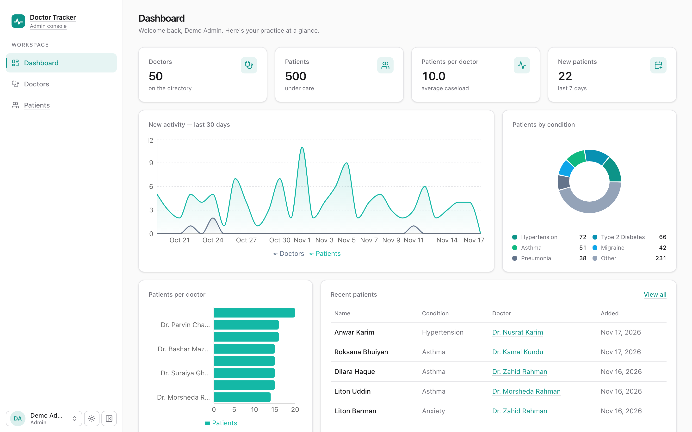
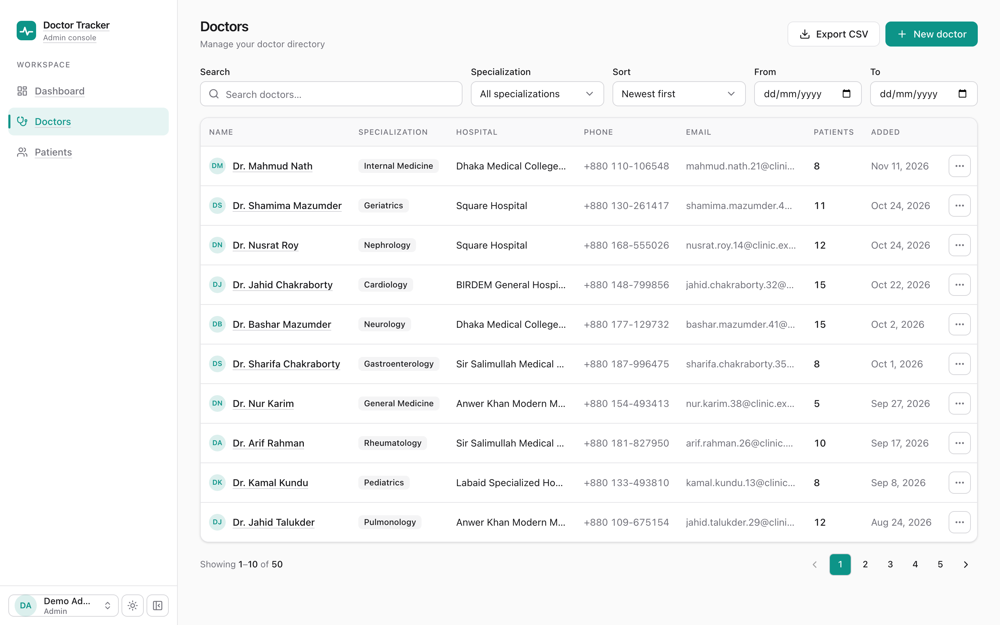
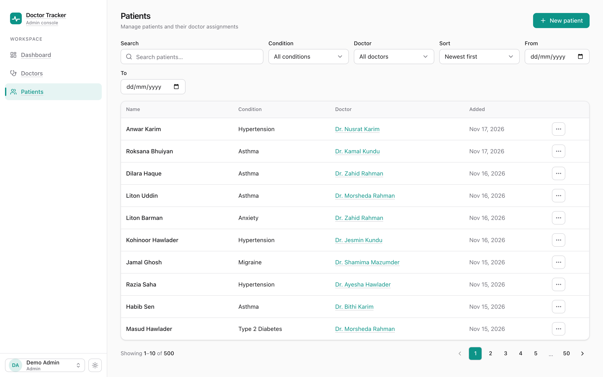
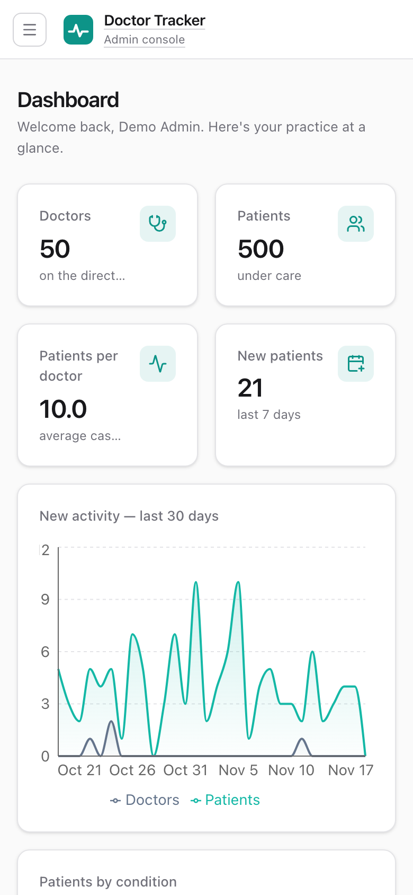
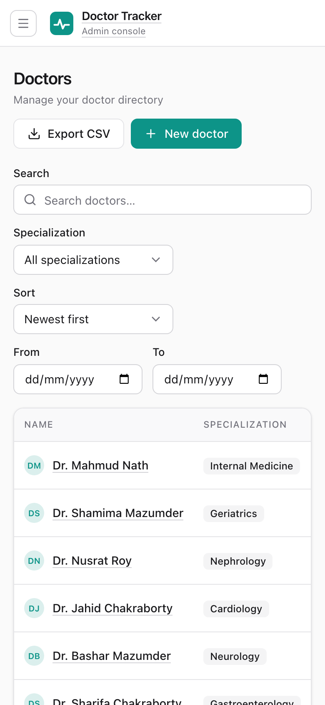
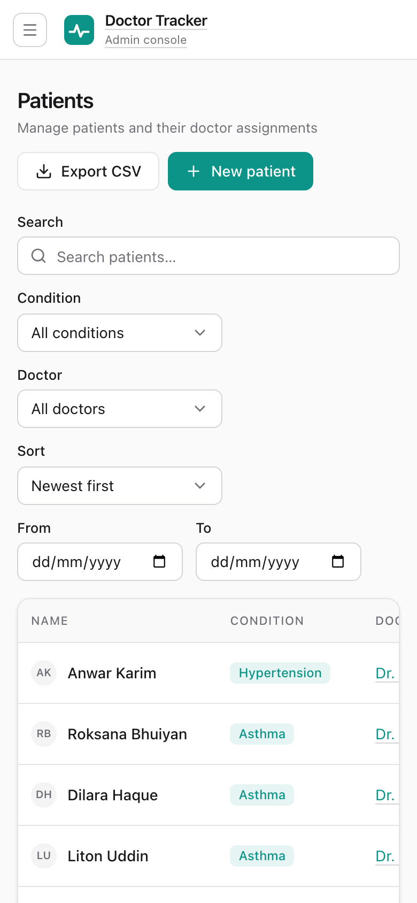
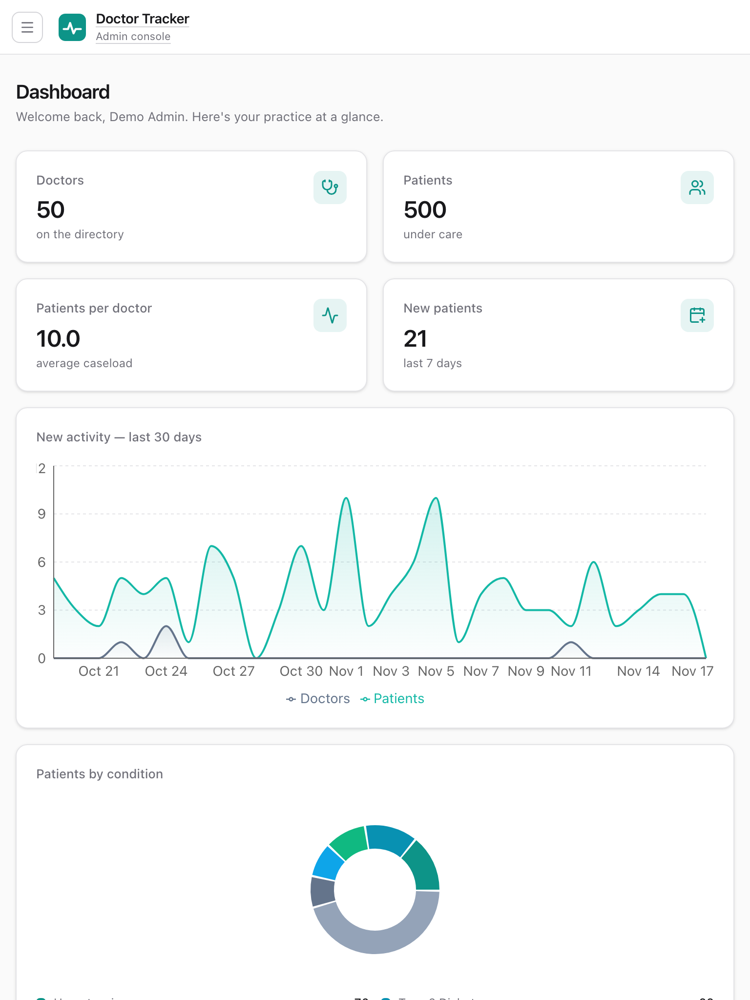

# Doctor Tracker

A secure admin app for managing doctors and their patients. Sign in with email/password, land on a live analytics dashboard, and work with fully searchable, filterable, paginated doctor and patient tables — backed by a REST API where every non-health route is behind session auth.

**Live demo:** [doctor-tracker-tau-sage.vercel.app](https://doctor-tracker-tau-sage.vercel.app)

| Dashboard | Doctors | Patients |
| --- | --- | --- |
|  |  |  |

<details>
<summary>Mobile &amp; tablet views</summary>

   

</details>

## Features

- **Session auth + roles** — better-auth email/password; httpOnly cookies; every `/api/*` route except `/api/health` requires a session, and all app pages gate server-side before render. Two roles: **admin** (full CRUD) and **viewer** (read-only — mutations return 403 and the UI hides them). Demo accounts after `npm run seed:users -w server`: `admin@doctor-tracker.dev` / `Admin1234!` and `viewer@doctor-tracker.dev` / `Viewer1234!`.
- **Doctors** — list with search (name/specialization/hospital/email), specialization filter, `createdAt` date range, column sort, pagination; create/edit/delete dialogs; deleting a doctor cascades to their patients.
- **Doctor detail** — doctor card plus their patient roster with the same filter/search/pagination controls.
- **Patients** — list with search (name/condition), condition and doctor filters, sort, pagination; each row embeds its doctor and links to the detail page; create/edit/delete with doctor reassignment.
- **Dashboard** — totals (doctors, patients, new this month), 30-day activity chart, top-5 conditions pie, busiest specializations, recent patients.
- **Responsive + accessible** — tables scroll safely on mobile, coarse-pointer touch targets, focus-visible rings, `prefers-reduced-motion` support, dark mode.
- **SEO** — full `Metadata` API coverage (per-page titles, dynamic doctor titles), generated Open Graph + Twitter card images, `robots.txt`, `sitemap.xml`, theme colour + viewport config.
- **Hardened API** — helmet security headers, gzip compression, rate limiting (`/api/auth` 200/15min, `/api` 1000/15min), 100kb JSON body cap, centralized error/404 handling, graceful shutdown on SIGTERM/SIGINT.

## Tech stack

| Layer | Choice |
| --- | --- |
| Frontend | Next.js 16 (App Router), React 19, Tailwind CSS 4 |
| UI kit | **ui-sdk** headless components (`@ui-sdk/react`), styled with Tailwind |
| Data | TanStack Query (server state), TanStack Table, TanStack Form + zod |
| Charts | Recharts |
| Backend | Express 5, zod validation, better-auth |
| DB | MongoDB Atlas + Mongoose |
| Tooling | npm workspaces, vite-plus (dev/check/test), oxlint + oxfmt (Ultracite), varlock (typed env) |

### Why REST instead of tRPC?

The API is a plain Express REST service mounted at `/api`. tRPC would couple the contract to a TypeScript client generator and to co-location with the web app — this app needs neither: the contract is small and stable, and REST keeps the API usable by non-TypeScript consumers, curl, and the Vercel multi-service deployment where `server` is its own function. zod schemas on both ends provide the safety tRPC would have, without the code-gen step.

### Why TanStack Query for data, and ui-sdk for components?

- **TanStack Query** owns all server state: cache, dedupe, background refetch, optimistic mutations with rollback, and a global 401 → login redirect. Components never call `fetch` directly — everything goes through typed hooks over `apiFetch` in `apps/web/src/lib/api.ts`.
- **ui-sdk** is the repo's component system: headless primitives (`@ui-sdk/react/*` per-entry imports) styled with Tailwind tokens. It ships real a11y behavior (focus management, ARIA, keyboard nav) without locking the visual design the way a pre-styled kit (shadcn-style defaults) would.

## Architecture

```
doctor-tracker/                     (npm workspaces)
├── apps/
│   ├── web/        Next.js 16 frontend — localhost:3001
│   │   └── src/
│   │       ├── app/        dashboard / doctors / doctors/[id] / patients / login
│   │       ├── components/ tables, dialogs, forms, toolbar, logo
│   │       └── lib/        api.ts (apiFetch), hooks/, auth-client
│   └── server/     Express 5 API — localhost:3000 (entry: src/index.ts)
└── packages/
    ├── api/        Routers: doctors, patients, stats + shared listing/validation helpers
    ├── auth/       better-auth config (MongoDB adapter, email/password)
    └── db/         Mongoose models (doctor, patient, auth), createDb, seed script
```

Request flow: browser → Next.js pages (server-side session check → `/login` redirect) → client TanStack Query hooks → `apiFetch` → `/api/*` → Express → `createRequireAuth` → zod-validated router → Mongoose → Atlas.

List endpoints share one contract: `?page&limit&search&sort=field:asc|desc&from&to` plus per-resource filters, returning `{ data, total, page, limit, totalPages }`. Errors return `{ error, issues? }` with 400/401/404 semantics (201 create, 204 delete).

## Getting started

```bash
npm install
```

### Environment

Each app owns a varlock `.env.schema` — copy the examples and fill them in:

```bash
cp apps/server/.env.example apps/server/.env
cp apps/web/.env.example apps/web/.env
```

`apps/server/.env`:

| Key                  | Value                                          |
| -------------------- | ---------------------------------------------- |
| `DATABASE_URL`       | MongoDB connection string (`…/doctor_tracker`) |
| `BETTER_AUTH_SECRET` | Random 32+ char secret                         |
| `BETTER_AUTH_URL`    | `http://localhost:3000`                        |
| `CORS_ORIGIN`        | `http://localhost:3001`                        |
| `NODE_ENV`           | `development`                                  |

`apps/web/.env`:

| Key                      | Value                   |
| ------------------------ | ----------------------- |
| `NEXT_PUBLIC_SERVER_URL` | `http://localhost:3000` |
| `NODE_ENV`               | `development`           |

### Seed + run

```bash
npm run seed -w @doctor-tracker/db   # 50 doctors, 500 patients (Bangladeshi demo
                                     # data) into Atlas — wipe + reseed; volume is
                                     # tunable via SEED_DOCTORS / SEED_PATIENTS
npm run seed:users -w server         # demo admin + viewer accounts
npm run dev                          # web :3001 + server :3000
```

Open http://localhost:3001 — you'll be redirected to `/login`; create an account to enter.

## Testing

```bash
npm run check    # format + lint + typecheck across workspaces
npx vp test      # 42 route tests (mongodb-memory-server): auth + role gates,
                 # validation, pagination, doctor/patient CRUD, stats
```

## Deployment (Vercel services)

`vercel.json` deploys both apps as one multi-service project:

- **`server`** (`apps/server`, Express) — internal except `/api/*`
- **`web`** (`apps/web`, Next.js) — public on `/(.*)`, with a `SERVER_URL` service binding for server-side auth calls

Top-level rewrites route `/api/(.*)` → `server`, everything else → `web`. In production the browser calls **same-origin** `/api` (no CORS), so `NEXT_PUBLIC_SERVER_URL` should be left unset in Vercel. Set on the project: `DATABASE_URL`, `BETTER_AUTH_SECRET`, `BETTER_AUTH_URL` = public site URL, `CORS_ORIGIN` = same public URL, `NEXT_PUBLIC_APP_URL` = same public URL (canonical `og:url`/`metadataBase`), `_VARLOCK_ENV_KEY` (varlock build encryption key — `npx varlock generate-key`).

On Vercel the server bypasses varlock at runtime (no CLI in the function bundle) and reads `process.env` directly; locally `varlock/auto-load` still resolves `.env` files.

## API surface

```
GET  /api/health                      (public)
GET  /api/me
/api/doctors                          CRUD + list ?search&specialization&sort&page&limit&from&to
GET  /api/doctors/specializations
GET  /api/doctors/:id/patients        scoped list, same filters
/api/patients                         CRUD + list ?search&condition&doctorId&sort&page&limit&from&to
GET  /api/patients/conditions
GET  /api/stats                       dashboard aggregations
/api/auth/*                           better-auth
```

All except `/api/health` and `/api/auth/*` require a session.
